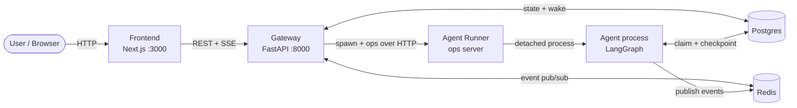

# Meiva

**A CodeAct, self-evolving multi-agent system.**


Meiva agents act by **writing code**, not by picking from a menu of tools. They
form a **fleet** — a graph of peers that spawn, fork, and message one another —
and they can **read and modify their own source**, shipping changes through
PR → CI → merge and then rolling the new code across the running cluster with
the fleet update script (`python -m cli.fleet_update`).

The core is deliberately small. From day one every layer is built asking *can
this scaffolding be stripped once the model is strong enough to not need it?* —
so the stronger the model gets, the less of Meiva there is. (The design thread is
in [`docs/conventions/philosophy.md`](conventions/philosophy.md).)

---

## 🚀 Quickstart

From zero to your first agent in about 15 minutes — full install guide with
screenshots, and FAQ: **[QUICKSTART.md](../QUICKSTART.md)**.

---

## Why Meiva

### 1. Self-Evolving — the cluster upgrades itself

Meiva's cluster upgrades itself. New code lands on `main`, and the fleet update
script (`python -m cli.fleet_update down` / `up`) updates every unit: agents
drain at their turn boundary (a wedged process holds the stop until its
timeout; only the operator's explicit `--force` cuts it short), the cluster
stops, each unit's source checkout switches to the released commit, and the
units start again. An update is an attended, full-cluster outage by design,
and it never rolls back on its own: a failure stops the half, the operator
fixes the cause and reruns it — each half is idempotent.

→ [Why: self-rolling release](decisions/runtime/updates/release/2026-05-09-self-rolling-release.md)

### 2. CodeAct — one tool, the whole Python namespace

Agents act by writing Python. One `execute_code` tool plus the whole `meiva.*`
namespace is every capability — files, network, search, memory, even spawning
other agents. No multi-tool dispatch, no per-capability JSON schema; the agent
orchestrates with real control flow. A `for`-loop can spawn and coordinate an
entire fleet:

```python
for product in products:
    meiva.agents.spawn(
        prompt=f"Research {product} from live sources; "
               f"write findings to out/{product}.md",
        label=f"research-{product}",
    )
meiva.watcher.launch(gather_wave_1, timeout="30m", name="gather-w1")
```

In a real production run, an agent decomposed a nine-product competitive
research goal into three waves of 18 workers by itself — wave split,
checkpoint placement, and model tiering were all its own choices — and the
orchestrator was woken only six times.

→ [Why a single tool](decisions/agents/graph/2026-05-04-single-execute-code-tool.md)

### 3. Fleet — a graph of peers, not a chain

Multi-agent is native: any agent can `spawn` a peer, `fork` another agent's
explored context, and `send_message` it directly — all peers, no central
scheduler. Ties form on spawn/fork/message and fade with time;
`get_neighbors` ranks who to talk to by tie strength, and `get_ancestors`
walks the spawn chain above an agent for responsibility attribution. Recovery
is decentralized too: a watcher wakes a supervisor the moment a worker stalls,
and a terminated agent auto-resurrects to handle an incoming message.

```python
worker = meiva.agents.spawn(
    prompt="Refactor the auth module; tests must stay green.",
    fork_from=meiva.self.AGENT_ID,   # inherit context — the edge is the dependency graph
    label="auth-refactor",
)
meiva.agents.send_message(worker, "Skip the legacy SAML path — out of scope.")
```

The human side is first-class as well: every agent's notifications — progress,
FYIs, decisions that need your call — converge into **one aggregated
notification queue**, and agents organize across conversations through a
**shared persistent task graph** (parent/child trees, owners, reminders).

→ [How the fleet works](../meiva_builtins/plugins/meiva_fleet/docs/meiva_fleet.meiva.okf.md)

### 4. Anti-RL-Bias — first-class verbs for intent

RLHF-tuned models carry two habits that hurt a long-lived agent: treating a
text turn as "I answered, therefore I'm done", and going quiet when unsure.
Meiva answers both from the system layer: explicit verbs declare intent
(`pause_heartbeat` says "I am deliberately waiting"), a heartbeat daemon
offers idle agents three honest options (working / waiting / done), and
mechanisms nudge agents that stall, reach for the wrong SDK idiom, or miss a
newly installed skill. Ambiguous silence becomes supervisable state.

→ [All anti-RL-bias mechanisms](../agent/docs/anti-rl-bias.meiva.okf.md)

### 5. Observability — every turn is a trace

Each agent turn records an OTel trace — standard OpenTelemetry format, LLM
content stripped at the source. One command starts a read-only Tempo + Loki +
Prometheus + Grafana stack where traces, logs, and metrics share a single UI.
Underneath, every signal is one unified event stream carrying a trace_id, so
logs and traces correlate; alerts reach chat end to end.

→ [How observability works](../base/telemetry/otlp/docs/telemetry-otlp/telemetry-otlp.meiva.okf.md)

### 6. Multi-Machine — a single box is the N=1 case

Multi-machine is the default, not a premium configuration. A cluster is one
gateway machine (owns the data plane) plus any number of agent-runner machines
(only execute agents); **any machines that are network-reachable to each other
form a cluster**. Authentication is always on and fail-closed. macOS and Linux
are supported. A single box is just the N=1 case: no flag, no opt-in.

→ [How multi-machine deployment works](decisions/runtime/updates/release/2026-06-11-multihost-deployment.md)

### 7. Plugins — typed extension points in the runtime

Plugins insert custom behavior into the agent execution graph at five
injection points (after init, before the LLM call, before/after code
execution, at context setup). A plugin registers a whole typed pydantic state
model that becomes a private channel in the agent's state graph — typed
read/write handles, fail-fast on conflicts, persisted with the framework
checkpoint. Write a `plugin.py`, drop it in a directory, done.

→ [How plugins work](plugins/plugins.meiva.okf.md)

### 8. Skills — the open Agent Skills standard, zero rewrite

Meiva reads the open Agent Skills standard (SKILL.md) — the format Claude Code
popularized, now shared by Codex, Cursor, and Gemini CLI. Any standard skill
folder installs unmodified: from a git URL or straight off disk, no manifest,
no conversion. A hundred installed skills cost a hundred description lines in
the prompt, not a hundred bodies — full text loads on demand.

→ [How skills work](skills/skills.meiva.okf.md)

### 9. Memory — a shared pool that outlives any conversation

Meiva agents share a memory pool that outlives any conversation: markdown notes
plus semantic search, visible to every agent. Long tasks are handed off
through notes, not conversation context — restart, compaction, or a new agent
taking over loses nothing. A steward agent consolidates, health-checks, and
commits the pool daily; the index is injected at cold start and after each
compaction, so standing rules stay in front of the agent.

→ [How memory works](../meiva_builtins/plugins/meiva_memory/docs/meiva_memory.meiva.okf.md)

---

## Where Meiva sits in the landscape

The [agent landscape](../assets/agent-landscape-2026.html) compares ten products
across fifteen capability dimensions and five behavioral safeguards. Its
October 7, 2026 incremental review links official evidence for refreshed entries;
untouched July/August entries are explicitly marked as historical baselines.
Optional Code Mode, scripted agent orchestration and goal continuation are now
documented in several competitors. Capability presence alone is a weak comparison.

Meiva's commitments connect those capabilities to how work gets done:

| Commitment | What it enables | Boundary |
|---|---|---|
| One CodeAct entrance | Python composes tools, verification and orchestration through `execute_code` | Code execution is not a runtime sandbox |
| One persistent peer lifecycle | Executor, reviewer and supervisor are roles of an ordinary agent with usable identity and context | Persistent identity does not make external effects exactly-once |
| Outcome-driven continuation | [Goal](../meiva_builtins/skills/coordination/meiva-goal/SKILL.md) keeps an authorized outcome in view; completion requires artifact evidence | Goal is optional; pauses and handoffs must be respected |
| Adjustable working methods | [Workflow](../meiva_builtins/skills/practice/meiva-workflow/SKILL.md) selects alignment, direct work, evaluation, peer collaboration or script orchestration | No fixed watcher/worker topology or guaranteed skill invocation |
| Investment in future work | Instructions, memory and [self-evolution](../meiva_builtins/skills/platform/meiva-self-evolution/SKILL.md) preserve useful corrections and follow-ups | Source promotion requires review and separately authorized rollout |

These mechanisms target premature completion and shallow verification, behaviors
often described as laziness or short-term RL bias. This is a design intention,
not evidence that Meiva has changed a model's training bias or achieved a measured
advantage over other harnesses. The chart separates mechanism availability,
evaluator access, recovery and cost scope from effectiveness claims.

---

## Drive Meiva from Claude Code / Codex

The gateway `/mcp` endpoint exposes the cluster's control plane as an MCP server over
Streamable HTTP, so a coding agent can run the fleet: start agents, message them,
read what they did, stop them. Create a client token and register it once
(setup: [`docs/conventions/extensions/mcp-client-access.md`](conventions/extensions/mcp-client-access.md)) —

```bash
claude mcp add --transport http meiva http://<gateway-host>/mcp \
  --header "Authorization: Bearer <mcp-client-token>"
```

(Codex: `codex mcp add`, same shape) — and then just ask: *"spawn an Meiva agent to watch the CI queue and ping me when
it goes red"*, *"what is agent 42 doing?"*, *"tell it to skip the flaky test"*.

| Tool | Does |
|---|---|
| `spawn_agent` | start an agent on a goal; returns its id immediately |
| `send_message` | send a running agent an instruction, context, or an answer |
| `list_agents` | every agent with its live status, optionally filtered |
| `get_agent` | one agent's full state, including questions it is blocked on |
| `get_messages` | its transcript — what it said and the code it ran |
| `terminate_agent` | end an agent (destructive: it stops working) |
| `cluster_status` | is the cluster up, and is it paused for maintenance |

Which cluster it drives is not a flag: the endpoint belongs to the gateway it is
served from, and every call authenticates with that cluster's own client token.
The tools are thin handlers over the same functions the web UI's gateway routes call.

> The rest of the `meiva mcp` family runs the other direction: `install` / `add` /
> `list` configure MCP servers Meiva's *own* agents call out to.

---

## CLI

One entry point — `meiva`. Every verb acts on the home `$MEIVA_HOME` names (`~/.meiva`
for prod when it is unset); a home with its own `source` checkout is operated only by
that checkout's `meiva`; any other checkout's `meiva` refuses every command. Run `meiva --help`
for the full surface.

| Verb | Does |
|---|---|
| `meiva init` | record this host's identity once (machine name, capabilities, gateway URL); starts nothing |
| `meiva start` | bring up an initialized host's stack (idempotent); takes only the service selection |
| `meiva stop` / `meiva restart` | tear down / bounce this host |
| `meiva status` | one-screen view: sessions, pg/redis/pgbouncer, healthchecks |
| `meiva logs` | list live service sessions or tail one |
| `python -m cli.fleet_update` | roll the latest merged code across a networked cluster over SSH (`down`, then `up`) — the only update path |
| `meiva cluster status/destroy` | multi-machine roster + decommission of this host's cluster |
| `.venv/bin/meiva init --no-serve-gateway --serve-agent-runner --gateway-url <url> --db-capability <bundle>` | init of a split-deployment agent-runner joining a gateway, then `meiva start` (its checkout's CLI — `meiva` on PATH does not exist yet; with the bundle's `MEIVA_DB_CAPABILITY_KEY` exported) |
| `meiva agents` | observe + control agents (ls / cancel / restart / terminate) |
| `meiva schedules` | gateway-supervised schedules (cron jobs agents create and own) |
| `meiva skill install <src>` | install Agent Skills from a git URL or local path |
| `meiva plugins` / `meiva mcp` | manage plugins and MCP servers |
| `meiva memory` | shared memory pool operations |
| `meiva config` / `meiva notices` / `meiva trace` | config get/set, the notification queue, the trace mirror |

---

## Architecture

A user message flows through five components: the **Frontend** (web UI), the
**Gateway** (the one HTTP control surface + the only thing that touches the data
plane), the **Agent Runner** (the host capability that runs agent processes),
**Postgres** (all durable state + the wake bus), and **Redis** (the real-time
event stream).



The `gateway` and `agent-runner` capabilities can live on **one box** or be
**split** across machines. Full component breakdown, data-flow walkthrough, and
the agent graph topology are in the OKF knowledge graph, rooted at
[`docs/index.meiva.okf.md`](index.meiva.okf.md).

**No terminal UI, by design.** The Next.js console above is the only
supervision surface — plus chat channels (e.g. X, via `meiva mcp install`)
for talking to individual agents. An always-on fleet's state (many concurrent
agents, the spawn/fork/message graph, task tracking) doesn't compress into a
terminal's single-pane model without losing most of what supervision needs;
see [`docs/conventions/non-goals.md`](conventions/non-goals.md).

### Deployment footprint & memory

Postgres, Redis and LangGraph checkpoints retain durable agent context. One
`agent-host` daemon runs local agents as asyncio tasks; idle has no active task.
Bounded caches may retain model/runtime objects. Disposable execution children
and persistent PTY shells have their own resource lifetimes. Full verified breakdown:
[`docs/conventions/runbook.md#deployment-footprint--memory`](conventions/runbook.md#deployment-footprint--memory).

---

## Security model

Meiva does not sandbox model-authored code. `execute_code` runs the agent's
generated Python in a disposable subprocess on the host, with the
permissions of whichever user started it. The `before_exec` hook
([`demos/permission-hooks/`](../demos/permission-hooks)) can intercept dangerous
patterns before they run, but it is a mitigation layer, not a boundary.

The isolation Meiva relies on is **where you deploy the cluster** — a dedicated
OS user, machine, or VM per cluster — not a sandbox drawn around any single
agent's code. If you need a boundary the model's code cannot cross (untrusted
input, unattended automation), put a container or VM around the whole
cluster; that has to come from outside Meiva today. Full policy and reporting:
[`SECURITY.md`](../SECURITY.md).

---

## Stack

| Layer | Choice |
|---|---|
| DB | Postgres 17 |
| Cache | Redis 8.2 |
| Framework | LangGraph (8-node self-looping graph) |
| SDK | `meiva` (this repo) |
| Models | 8 providers side by side (DeepSeek, Claude, Gemini, GPT, MiMo, Kimi, GLM, Qwen) — picked once per agent at spawn, never routed at runtime ([why](conventions/non-goals.md)) |
| Package manager | uv |
| Frontend | Next.js 16 + React 19 + Tailwind 4 + shadcn/ui |

[Frontend stack →](../ui/web/docs/web.meiva.okf.md)
[Connection budget →](../agent/db/docs/db.meiva.okf.md)
[Model registry →](../base/lm/registry.py)

### Observability (OTel + LGTM)

Every agent turn records an OTel trace to a local OTLP/JSON mirror
(`$MEIVA_HOME/traces/` — metadata-only by default; LLM content is stripped at the
source), replayed to Tempo by `meiva trace ship`; the unified event stream
exports live over OTLP/HTTP to Loki (logs) and Prometheus (metrics). The
LGTM backend (remote Tempo plus native Loki, Prometheus, and Grafana) serves
Grafana at http://localhost:3003 — traces, logs, and metrics in one UI — and
backs the gateway's /ops + inspect endpoints:
[`deploy/lgtm/README.md`](../deploy/lgtm/README.md). See the
[trace mirror and delivery topology](../base/telemetry/otlp/docs/telemetry-otlp/trace-mirror.meiva.okf.md)
node for the full design.

## Key docs — read on demand

| When you need to… | Read |
|---|---|
| Get started | **[QUICKSTART.md](../QUICKSTART.md)** |
| Understand architecture | [`docs/index.meiva.okf.md`](index.meiva.okf.md) |
| Install / deploy | [`.agents/skills/meiva-guide/deploy/SKILL.md`](../meiva_builtins/skills/platform/meiva-guide/deploy/SKILL.md) |
| Set up dev environment | [`docs/conventions/dev-setup.md`](conventions/dev-setup.md) |
| Run ops / troubleshoot | [`docs/conventions/runbook.md`](conventions/runbook.md) |
| Write a PR | [CONTRIBUTING.md](../CONTRIBUTING.md) |
| Follow coding conventions | [`docs/conventions/python-conventions.md`](conventions/python-conventions.md) |
| Know what NOT to do | [`docs/conventions/non-goals.md`](conventions/non-goals.md) |
| See glossary | [`docs/index.meiva.okf.md`](index.meiva.okf.md) (OKF terminology sections) |

## Agent instruction files

`AGENTS.md` is this repo's entry point for all AI coding agents; Claude Code reads it (and `ui/web/AGENTS.md`) directly, so there is no `CLAUDE.md`.

## Contributing

See [CONTRIBUTING.md](../CONTRIBUTING.md) for the fork-and-PR flow and the
coding conventions. Maintainers additionally follow the internal conventions
in [`AGENTS.md`](../AGENTS.md).

## License

[Apache-2.0](../LICENSE). Third-party component notices are in
[`THIRD-PARTY-NOTICES.md`](../THIRD-PARTY-NOTICES.md).
